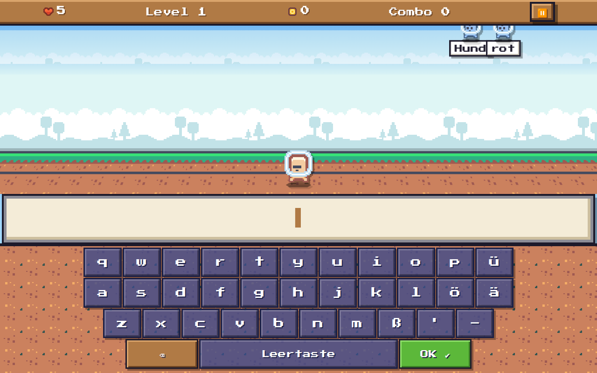
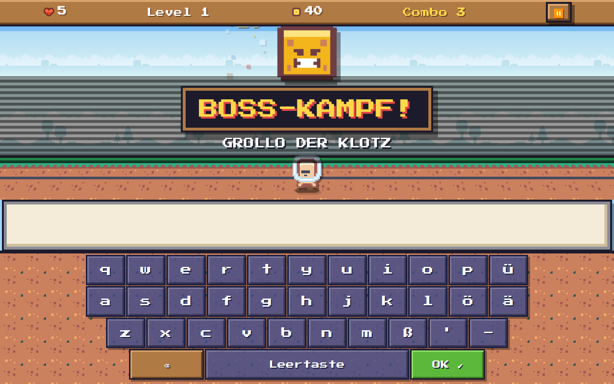
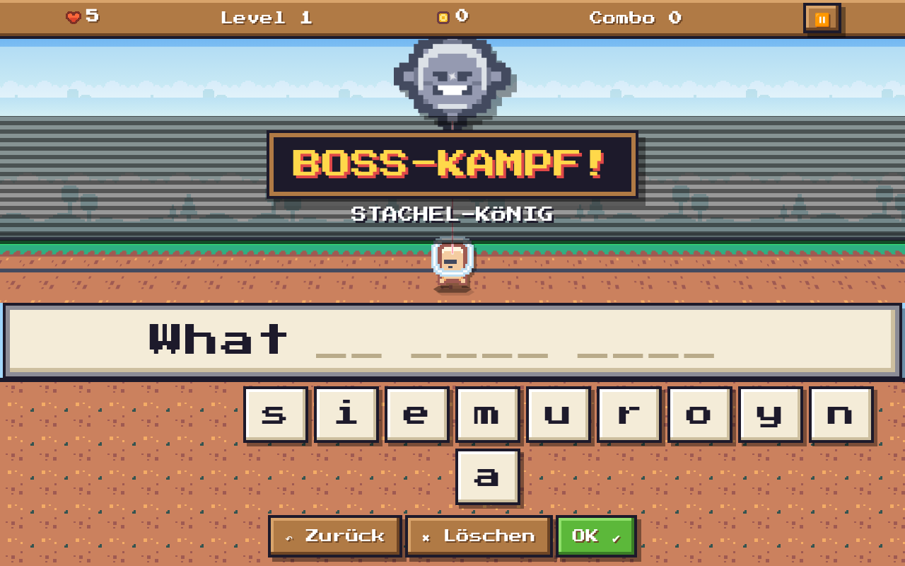
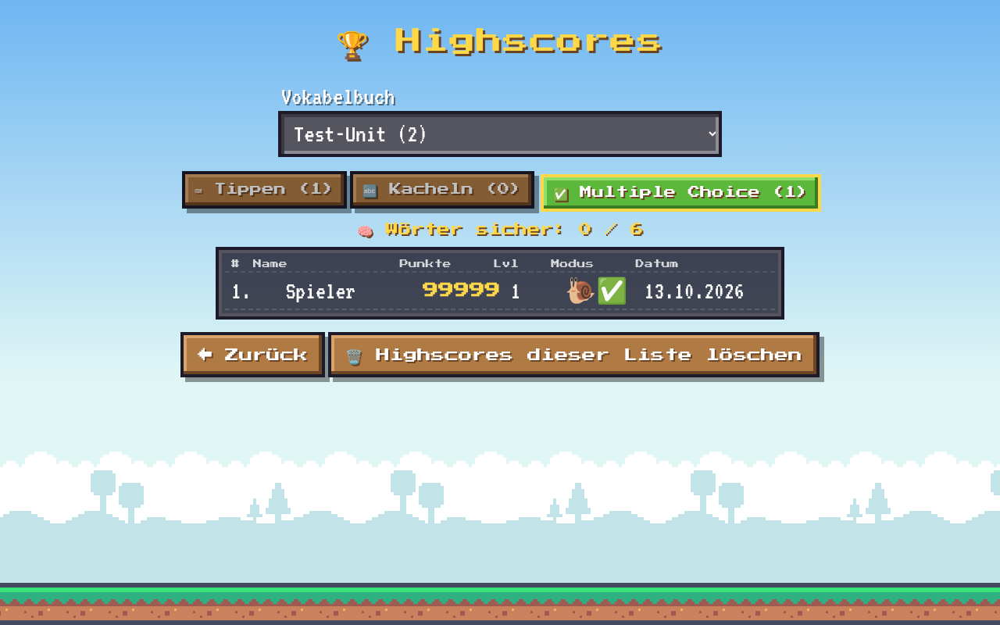
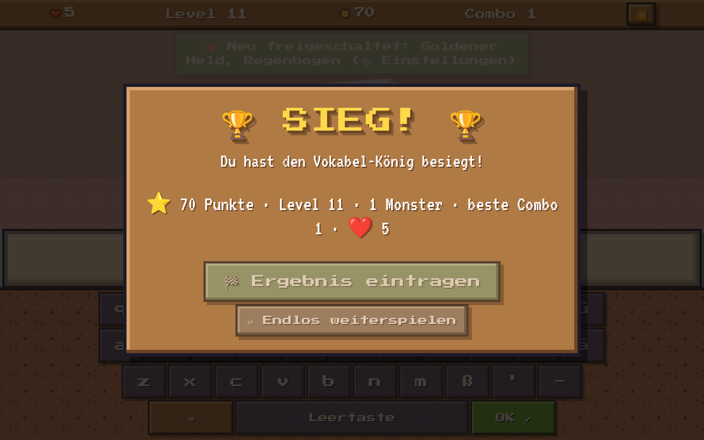

# Vokabel-Monster 👾

Ein kindgerechter Vokabeltrainer (Englisch ↔ Deutsch) im Pixel-Look, ähnlich wie „Typing of the Dead“, nur freundlich. Monster fallen vom Himmel und tragen ein Wort. Wer die Übersetzung richtig eingibt, schießt sie mit der Laser-Pistole ab.
Er läuft als **Web-App (PWA, offline)** im Browser, z. B. Edge oder Chrome unter Windows, und als **Android-App** (Capacitor).



## Funktionen
- **Drei Antwort-Arten:** Tippen (Bildschirm- oder echte Tastatur, strenge Prüfung), Buchstaben-Kacheln (Wortlücken werden automatisch gesetzt) und Multiple Choice.
- **Tempo:** Ohne Zeitlimit, Sehr langsam (Standard), Langsam, Normal, Schnell und Challenger. Lange Wörter fallen langsamer.
- **Freundliche Korrektur:** Bei einem Fehler pausiert das Spiel, und eine Karte zeigt die Lösung Buchstabe für Buchstabe. Falsche Buchstaben sind markiert, und das Wort kann vorgelesen werden.
- **Bosse:** Satz-Bosse, Revanche-Bosse für verpasste Wörter (3 Treffer) und nach Level 10 ein Endboss (5 Treffer). Danach kommt ein Siegerbildschirm, und man kann im Endlos-Modus weiterspielen.
- **Welten** (nur Optik): Wiese, Wald, Wüste, Schnee, Höhle, Unterwelt und Himmelsinsel.
- **Highscores:** Top 10 pro Vokabelliste und Antwort-Art, gespeichert nur lokal. Dazu freischaltbare Helden-Skins und Laserfarben.
- **Verteiltes Wiederholen:** Wörter kommen nach 1, 3, 7 und 14 Tagen wieder. Auf dem Startbildschirm steht „Wörter sicher: X / Y“.
- **Aussprache:** Englische Wörter werden vorgelesen, auf Android per Text-to-Speech-Plugin, im Browser über die Web Speech API.
- **Vokabel-Editor** in der App. Alle Vokabeln stehen in einer einzigen Datei `vokabeln.txt`.

| Boss-Intro | Kacheln | Highscores | Sieg |
|---|---|---|---|
|  |  |  |  |

## Die Datei `vokabeln.txt`
```
# Kommentar
## Unit 1
dog;Hund
to go;gehen
rubber/eraser;Radiergummi
(the) cinema = Kino
What's your name?;Wie heißt du?
```
- `## Name` beginnt eine neue Liste. Zeilen mit `#` sind Kommentare.
- Eine Vokabel pro Zeile, **Englisch zuerst**. Als Trenner geht `;`, `=`, Tab oder Komma.
- Alternativen trennt man mit `/`. Ein Teil in `(Klammern)` ist optional.
- Sätze mit 3 oder mehr Wörtern werden zu Boss-Sätzen. Die Datei muss als UTF-8 gespeichert sein.
- Die Datei im Repo enthält nur Beispiel-Vokabeln. `vokabeln-data.js` wird mit `npm run bundle` daraus erzeugt und ist der Notfall-Fallback, wenn der Browser die Datei nicht lesen darf.

## Starten (Browser)
- Mit `npx serve` oder `python3 -m http.server` im Projektordner starten und `index.html` öffnen. Unter Windows geht auch `Vokabel-Monster starten.bat`, das Edge im Vollbild öffnet.
- In Edge oder Chrome verbindet man über „📄 vokabeln.txt verbinden“ die Datei. Danach liest und schreibt das Spiel sie direkt (File System Access API). In anderen Browsern wird die Datei nur gelesen, Änderungen sichert man per Export.

## Entwicklung und Tests
```
npm ci
npm test                         # Logik-Tests (node:test)
CHROME=/pfad/zu/chrome npm run e2e   # Headless-Chrome mit Touch-Emulation, Screenshots in test-e2e/screenshots/
```

## Android-App bauen
Benötigt werden Node 20+, Java 21 und das Android SDK (Build-Tools 36).
```
npm ci
npm run android                  # Web-Dateien nach www/ kopieren und npx cap sync android
cd android && ./gradlew assembleRelease
```
- **Signatur:** `android/keystore.properties.example` nach `android/keystore.properties` kopieren und ausfüllen, oder die Umgebungsvariablen `VM_KEYSTORE`, `VM_KEYSTORE_PASSWORD`, `VM_KEY_ALIAS` und `VM_KEY_PASSWORD` setzen. Ohne diese Angaben entsteht `app-release-unsigned.apk`, die man auch nachträglich mit `zipalign` und `apksigner` signieren kann.
- Den eigenen Keystore niemals einchecken. `.gitignore` schließt `*.jks`, `*.keystore` und `keystore.properties` aus.
- Für Updates einer installierten App muss immer derselbe Keystore verwendet werden.
- Die Paket-ID steht in `capacitor.config.json` (`appId`) und in `android/app/build.gradle`.

## Projektaufbau
- `index.html`, `style.css`, `app.js`: Oberfläche und Spiel
- `logic.js`: reine Logik (Prüfung, Dateiformat, Wiederholen), getestet in `test/`
- `store.js`: Dateizugriff (Android Filesystem, File System Access API oder nur lesen)
- `sw.js`: Service Worker für den Offline-Betrieb
- `img/`, `fonts/`: Grafiken und Schriften (Lizenzen unten)
- `android/`: Capacitor-Android-Projekt
- `tools/bundle.cjs`: erzeugt `vokabeln-data.js`

## Credits und Lizenzen
- Code: MIT (siehe `LICENSE`)
- Sprites, Kacheln und Hintergründe: **„Pixel Platformer“ von Kenney** (https://kenney.nl/assets/pixel-platformer), **CC0 1.0**. Details stehen in `img/CREDITS.txt`.
- Schriften: **Press Start 2P** (CodeMan38) und **VT323** (Peter Hull), SIL Open Font License 1.1, aus https://github.com/google/fonts
- Text-to-Speech auf Android: `@capacitor-community/text-to-speech` (MIT)
- Es werden keine Grafiken aus kommerziellen Spielen verwendet.
