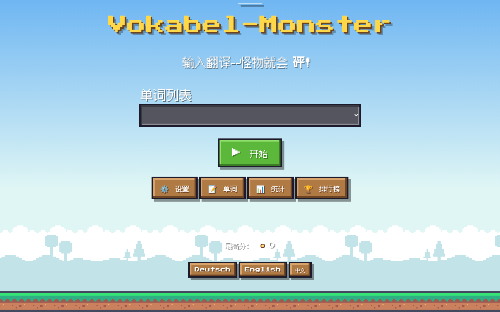
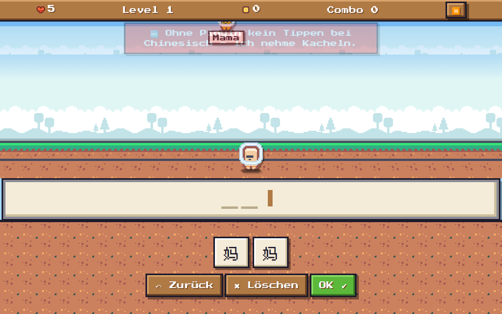
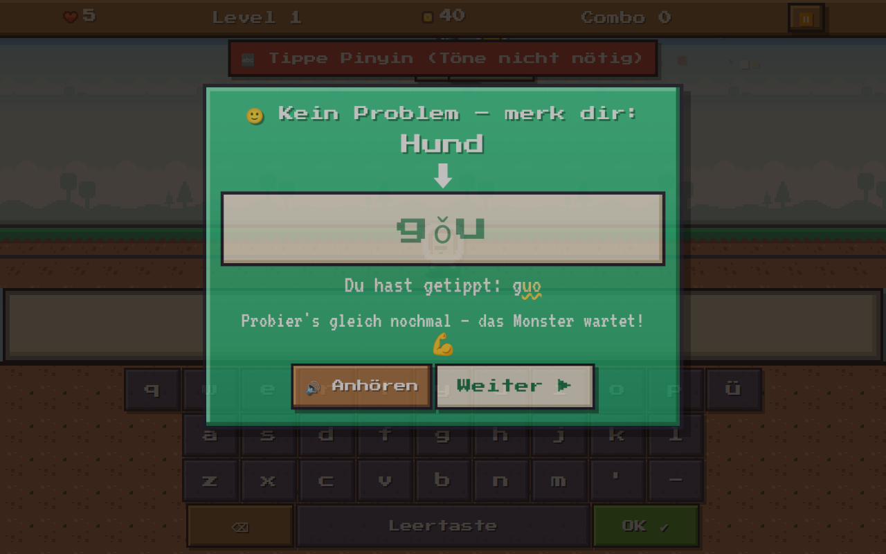

# Vokabel-Monster 👾

A kid-friendly vocabulary trainer in pixel-art style, a bit like “Typing of the Dead”, only friendly. Monsters fall from the sky carrying a word. Type the translation correctly and your laser pistol pops them.
It runs as a **web app (PWA, offline)** in the browser, e.g. Edge or Chrome on Windows, and as an **Android app** (Capacitor).

*Deutsche Beschreibung weiter unten.*


## Features
- **UI in Deutsch, English or 中文** (Simplified Chinese). Defaults to the device language, otherwise German; switch in ⚙️ Settings or on the home screen. All strings live in `i18n.js`. Chinese text uses a bundled pixel CJK font (Fusion Pixel Font, OFL, subset ~130 KB).
- **Any language pair per list:** `## Name [zh-de]`, `## Name [es-en]` … (column 1 – column 2). Lists without a tag are `[en-de]`. Direction becomes “question language → answer language”, editor headers show the language names, pronunciation uses the language of column 1.
- **Three answer modes:** typing (on-screen or real keyboard, strict check), letter tiles (gaps filled automatically) and multiple choice. The on-screen keyboard adapts to the answer language (umlauts/ß, Spanish/French accents).
- **Chinese:** `你好|nǐ hǎo` – with pinyin you type pinyin (tones and spaces optional). Without pinyin typing is disabled for that list and the game uses Hanzi tiles or multiple choice.
- **Speed:** no time limit, very slow (default), slow, normal, fast and challenger. Long words fall more slowly.
- **Friendly correction:** after a mistake the game pauses and a card shows the solution letter by letter, with wrong letters marked and optional pronunciation.
- **Bosses:** sentence bosses, rematch bosses for missed words (3 hits) and a final boss after level 10 (5 hits), then a victory screen and endless mode.
- **Worlds** (cosmetic only), **high scores** (top 10 per list and answer mode, local only), unlockable hero skins and laser colours.
- **Spaced repetition:** words come back after 1, 3, 7 and 14 days; “words mastered: X / Y”.
- **Built-in editor.** All words are in one plain text file `vokabeln.txt`.

| Boss intro | Tiles | High scores | Victory |
|---|---|---|---|
|  |  |  |  |

| 中文 UI | Hanzi tiles | Pinyin correction |
|---|---|---|
|  |  |  |

## New in 1.9 – 1.13
- **Speech:** English (and every column-1 language) is spoken by the **system voice**. On Android that is the native text-to-speech engine (a female voice is preferred), in the browser it is the Web Speech API. There is a separate switch “🔊 Speech” (independent of sound effects), a test button and an info line that shows which voice is used. On Windows/Edge the voice list is loaded lazily (`voiceschanged`). If no English voice is installed, the default voice is used and the info line says so. If an online voice fails, it retries once with a local voice.
- **Rewards for solved problem words:** hero skins and laser colours unlock after 1, 3, 6, 10, 15 … words that were once wrong and are now known (triangular numbers).
- **Critical hits:** each word remembers your time per answer mode. Answering at least 10 % and at least 0.3 s faster than last time gives a **CRIT!** (+50 % points). Close to your best time there is a random **Lucky crit!**
- **New school year:** reset progress and rewards and keep your word lists (optionally keep high scores). A second button resets only the rewards.
- **Fixes:** on first start the first list is selected (no more “list is empty”). Letter tiles keep the word you started. Multiple choice with tiny lists borrows wrong answers from other lists with the same language pair. Android TTS and file access work without `@capacitor/core` via `bridge.js`.

## New in 1.8
- Editor changes are saved on the device immediately (local copy) and survive restarts, even without a connected `vokabeln.txt`. The local copy wins over the bundled example list (example only on first start or via “↺ Example words”).
- Big **“💾 Save”** button with “Saved ✔” feedback; it also writes to the connected file (Edge/Chrome) or `Documents/VokabelMonster/vokabeln.txt` (Android). Leaving the editor with unsaved changes asks first.

## The file `vokabeln.txt`
```
# comment
## Unit 1
dog;Hund
to go;gehen
rubber/eraser;Radiergummi
(the) cinema;Kino

## Chinese [zh-de]
你好|nǐ hǎo;hallo
书;Buch

## Spanish [es-en]
el niño;the boy
```
- `## Name` starts a list, optionally with a language pair `[xx-yy]` (codes: `de en zh es fr it pt tr pl ru nl la`). Lines starting with `#` are comments and are kept.
- One entry per line, the language you learn first (column 1). Separators: `;`, `=`, tab or comma.
- Alternatives with `/`, optional parts in `(brackets)`. Chinese pinyin after `|`.
- Sentences with 3+ words become boss sentences. Save as UTF-8.
- The repo only contains example words. `vokabeln-data.js` is generated from it with `npm run bundle` (fallback if the browser may not read the file).

## Run (browser)
- Serve the folder (`npx serve` or `python3 -m http.server`) and open `index.html`. On Windows `Vokabel-Monster starten.bat` opens Edge in full screen.
- In Edge/Chrome use “📄 Connect vokabeln.txt” to read and write the file directly (File System Access API). Other browsers read only; save changes via export.

## Development and tests
```
npm ci
npm test                              # unit tests (node:test): logic, i18n, rewards, crit/reset, speech
CHROME=/path/to/chrome npm run e2e    # headless Chrome with touch emulation (test-e2e/tap.mjs + sweep.mjs),
                                      # screenshots in test-e2e/screenshots/
```

## Build the Android app
Needs Node 20+, Java 21 and the Android SDK (build tools 36).
```
npm ci
npm run android                       # copy web files to www/ and npx cap sync android
cd android && ./gradlew assembleRelease
```
- **Signing:** copy `android/keystore.properties.example` to `android/keystore.properties` and fill it in, or set `VM_KEYSTORE`, `VM_KEYSTORE_PASSWORD`, `VM_KEY_ALIAS`, `VM_KEY_PASSWORD`. Without them you get `app-release-unsigned.apk`, which you can sign later with `zipalign` and `apksigner`.
- Never commit your keystore. `.gitignore` excludes `*.jks`, `*.keystore` and `keystore.properties`. Always use the same keystore for updates.
- The package id is in `capacitor.config.json` (`appId`) and `android/app/build.gradle`.

## Project layout
- `index.html`, `style.css`, `app.js`: UI and game · `i18n.js`: UI strings (DE/EN/中文)
- `logic.js`: pure logic (checking, file format, language pairs, pinyin, repetition), tested in `test/`
- `bridge.js`: calls the native Capacitor plugins (TextToSpeech, Filesystem) without `@capacitor/core`
- `store.js`: file access (Android Filesystem, File System Access API or read only) · `sw.js`: service worker (offline)
- `img/`, `fonts/`: graphics and fonts (licences below) · `android/`: Capacitor Android project
- `tools/bundle.cjs`: generates `vokabeln-data.js` · `tools/font-subset.mjs`: generates the CJK font subset

## Credits and licences
- Code: **MIT License** (see `LICENSE`). The MIT license covers the code only. Third-party assets in `img/` and `fonts/` keep their own licenses (listed below).
- Sprites, tiles and backgrounds: **“Pixel Platformer” by Kenney** (https://kenney.nl/assets/pixel-platformer), **CC0 1.0**, see `img/CREDITS.txt`.
- Fonts: **Press Start 2P** (CodeMan38) and **VT323** (Peter Hull), **SIL Open Font License 1.1**, from https://github.com/google/fonts, licences in `fonts/OFL-PressStart2P.txt` and `fonts/OFL-VT323.txt`
- Chinese font: **Fusion Pixel Font** by TakWolf (v2026.09.25, 12px proportional zh_hans), https://github.com/TakWolf/fusion-pixel-font, **SIL Open Font License 1.1**. Subset in `fonts/FusionPixel-12px-zh_hans-subset.woff2`, licences in `fonts/OFL-FusionPixel.txt` and `fonts/FusionPixel-LICENSES/`, details in `fonts/README-fonts.txt`.
- Text-to-speech on Android: `@capacitor-community/text-to-speech` (MIT); in the browser the Web Speech API of the system. No recorded voices are bundled.
- No graphics from commercial games are used.

---

## Deutsch

Ein kindgerechter Vokabeltrainer im Pixel-Look, ähnlich wie „Typing of the Dead“, nur freundlich. Monster fallen vom Himmel und tragen ein Wort. Wer die Übersetzung richtig eingibt, schießt sie mit der Laser-Pistole ab. Läuft als Web-App (PWA, offline) im Browser und als Android-App.

- **Oberfläche auf Deutsch, English oder 中文**, Standard ist die Gerätesprache, sonst Deutsch. Umschalten in ⚙️ Einstellungen oder auf der Startseite.
- **Sprachpaar pro Liste:** `## Name [zh-de]` = Spalte 1 Chinesisch, Spalte 2 Deutsch; ohne Angabe `[en-de]`, alte Dateien laufen unverändert. Die Richtung zeigt „Frage-Sprache → Antwort-Sprache“, der Editor die Sprachnamen, die Aussprache nutzt die Sprache von Spalte 1.
- **Antwort-Arten:** Tippen (strenge Prüfung, Akzente zählen), Buchstaben-Kacheln und Multiple Choice. Die Bildschirm-Tastatur passt sich an (ü ö ä ß, ñ á é …).
- **Chinesisch:** `你好|nǐ hǎo;hallo` – mit Pinyin tippst du Pinyin (Töne und Leerzeichen egal). Ohne Pinyin gibt es für die Liste kein Tippen, dann kommen Kacheln mit Schriftzeichen oder Multiple Choice, mit Hinweis.
- **Neu in 1.9 – 1.13:** Aussprache mit der Systemstimme (Android-TTS, im Browser Web Speech; eigener Schalter, Test-Knopf, Info-Zeile, unter Windows Hinweis, wenn keine englische Stimme installiert ist). Belohnungen für gelöste Problemwörter (1, 3, 6, 10, 15 …). Krit-Treffer bei schnellerer Antwort (+50 %) und Glückstreffer. „Neues Schuljahr“: Fortschritt zurücksetzen, Listen bleiben; oder nur Belohnungen zurücksetzen. Beim Erststart ist die erste Liste gewählt.
- **Neu in 1.8:** Änderungen im Editor werden sofort auf dem Gerät gespeichert und überstehen jeden Neustart, auch ohne verbundene Datei. Großer Knopf „💾 Speichern“ mit „Gespeichert ✔“; schreibt auch in die verbundene Datei bzw. auf Android nach `Dokumente/VokabelMonster/vokabeln.txt`. Beim Verlassen mit ungespeicherten Änderungen kommt eine Warnung.
- Tempo-Stufen, freundliche Korrekturkarte, Bosse, Endboss, Welten, Highscores pro Liste und Antwort-Art, Belohnungen, verteiltes Wiederholen und ein eingebauter Editor.
- Bauen, Testen und Signieren wie oben beschrieben. Den eigenen Keystore nie einchecken.
