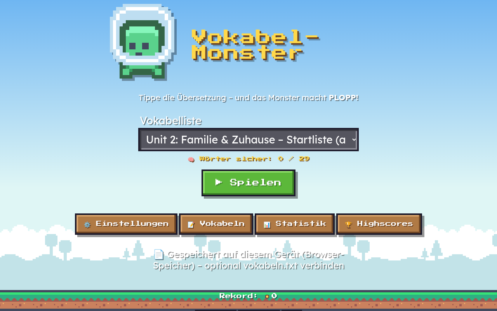
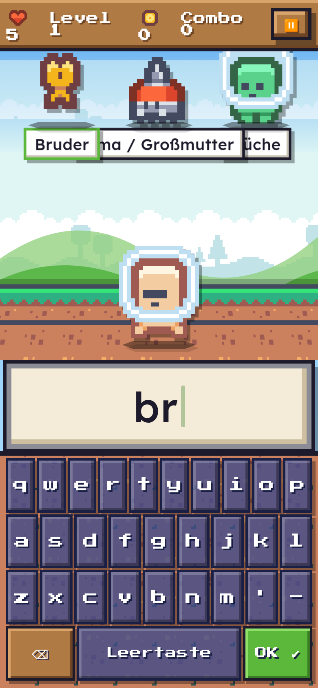

# Vokabel-Monster 👾 (Version 1.15)

Englisch-Vokabeltrainer im Stil von „Typing of the Dead“, nur kindgerecht. Lustige Monster und Aliens fallen langsam nach unten und tragen jeweils ein deutsches Wort. Wer die englische Übersetzung tippt, lässt das Monster mit **PLOPP** platzen. Läuft auf dem Android-Tablet (APK) und unter Windows im Browser, auch mit Touchscreen.

## Neu in 1.15 – alle Wörter einer langen Liste kommen dran
- Bisher wurde jedes Monster-Wort mit einem einzigen gewichteten Zufallszug gewählt. Problemwörter wogen bis zu 5× so viel wie neue Wörter, am nächsten Tag waren alte fällige Wörter fast so schwer wie neue, und im selben Spiel kamen Wörter oft doppelt. Bei 64 Wörtern blieben deshalb viele Wörter lange unbekannt.
- **Neue Auswahl in Töpfen:** Erst wird ein Topf gewählt, dann ein Wort daraus.

  | Topf | Anteil | Auswahl im Topf |
  |---|---|---|
  | neu (noch nie dran) | 6 | gleich verteilt, keine Bevorzugung der ersten Zeilen |
  | Problemwort | 2,5 | nach Anzahl Fehler |
  | fällig (verteiltes Wiederholen) | 1,5 | nach Überfälligkeit |
  | gelernt, nicht fällig | 0,4 | am längsten nicht gesehen zuerst |

  Es zählen nur Töpfe, die gerade Wörter enthalten. Gelernte Wörter kommen also weiter ab und zu dran.
- **Keine Wiederholung:** Die letzten Wörter dieses Spiels (bis zu 12, bei kurzen Listen die Hälfte) und die gerade sichtbaren werden übersprungen, solange es andere gibt. Doppelte Zeilen zählen einmal. Rache-Monster für Fehler bleiben wie bisher.
- **Simulation** `node tools/sim-coverage.mjs` (64 Wörter, Anfänger mit 50/70 % Treffern, 20 Monster pro Spiel, 3 Spiele pro Tag), Wörter gesehen nach Spiel 1–7:
  - vorher Ø 14 · 25 · 34 · 39 · 44 · 49 · 52, nach 12 Spielen 62 (schlechtester Lauf 58)
  - jetzt Ø 15 · 26 · 36 · 46 · 56 · 63 · 64, spätestens im 7. Spiel alle 64

## Neu in 1.14 – „Wörter sicher“ zählt wieder
- Der Zähler „🧠 Wörter sicher: X / Y“ blieb bisher bei 0. Als „sicher“ galt nur ein Wort auf Stufe 3 des verteilten Wiederholens. Dafür brauchte es richtige Antworten an mindestens drei Tagen über mindestens 4 Tage verteilt, und mehrere Runden am selben Tag zählten nur als ein Schritt.
- Jetzt gilt ein Wort als **sicher**, wenn es **3× hintereinander beim ersten Versuch richtig** war, auch in mehreren Spielen am selben Tag. Ein Fehler macht es wieder zum Problemwort und setzt die Serie auf 0. Der bisherige Spielstand zählt sofort mit, weil die Serien schon gespeichert sind.
- Welche Wörter drankommen, steuert weiter das verteilte Wiederholen (fällig nach 1, 3, 7, 14 Tagen).

## Neu in 1.13 – Sprachausgabe unter Windows/Edge, Erststart
- **Windows (Edge/Chrome):** Nach richtigen Antworten wird wieder gesprochen. Bisher wurde gar nicht gesprochen, wenn die Stimmenliste beim Start noch leer war (`voiceschanged` kommt erst später) oder Windows keine englische Stimme hatte. Nur der 🔊-Test-Knopf ging dann.
- Die Stimmenliste wird nachgeladen. Bevorzugt wird eine weibliche englische Stimme (lokal vor online). Ohne englische Stimme spricht die Standardstimme mit Sprache en-GB.
- Wenn eine Online-Stimme ohne Internet scheitert, wird einmal mit einer lokalen bzw. der Standardstimme wiederholt.
- Die Äußerung wird festgehalten (Chrome-GC-Fehler). `cancel()` wird nur aufgerufen, wenn gerade gesprochen wird, und `resume()`, wenn die Ausgabe pausiert ist.
- **Info-Zeile** in den Einstellungen: Sie zeigt die englische Stimme (mit „(online)“). Wenn keine installiert ist, steht dort „keine englische Stimme installiert – Standardstimme“.
  Abhilfe unter Windows: Einstellungen → Zeit und Sprache → Sprache & Region → Englisch (Vereinigtes Königreich) hinzufügen (mit Sprachausgabe).
- **Erststart:** Wenn noch keine Liste gewählt war (frische Installation), kam beim Spielen „Diese Liste ist leer“. Jetzt wird die erste Liste gewählt und gemerkt. Das gilt auch für eine gespeicherte, inzwischen gelöschte Liste.

## Neu in 1.12 – Aussprache nur mit der Systemstimme
- Nach jeder richtigen Antwort spricht die **Sprachausgabe des Geräts** das Wort (Lernsprache = Spalte 1 der Liste, z. B. Englisch en-GB, Chinesisch zh-CN). Wenn das Gerät mehrere Stimmen hat, wird eine **weibliche** bevorzugt (Erkennung über den Stimmennamen). So klingen auch neue, selbst eingetragene Wörter gleich. Im Browser kommt die Web-Speech-Stimme.
- Die vorab erzeugten Piper-Aufnahmen aus 1.11 sind wieder entfernt (APK kleiner).
- ⚙️: „🗣 Sprachausgabe (weibliche Stimme)“ (Standard an, unabhängig von „Töne“), „🔊 Test“ und eine Info-Zeile mit der benutzten Stimme. Tipp fürs Tablet: Android-Einstellungen → Sprachausgabe (Text-in-Sprache) → Google-Sprachausgabe, Englisch (UK) installieren und dort eine Frauenstimme wählen.

- ⚙️ **„🎁 Nur Belohnungen zurücksetzen“** (mit Bestätigung): sperrt die Belohnungen wieder und setzt den Zähler gelöster Problemwörter auf 0, Held/Laser zurück auf Standard. Zeiten, Statistik, Vokabellisten und Highscores bleiben. Der große Reset „Neues Schuljahr“ bleibt daneben.
- **Glückstreffer:** Ist ein Wort schon so schnell, dass „schneller als letztes Mal“ kaum noch geht, gibt es trotzdem Krits: Fehlerfrei gelöst und höchstens 10 % über der Bestzeit → mit 18 % Wahrscheinlichkeit „GLÜCKSTREFFER!“ (grünes Banner, ebenfalls +50 %). Der normale Krit (mind. 10 % bzw. 0,3 s schneller als die letzte Zeit) hat Vorrang. Erster Versuch nie.

## Neu in 1.11 – Abschluss-Prüfung
- Warum die Aussprache auf Android bis 1.10 stumm war: Die App lädt `@capacitor/core` nicht, darum war `Capacitor.Plugins.TextToSpeech` leer, und die Android-WebView hat keine Web Speech API. `bridge.js` reicht die Plugins über die Native-Bridge nach. Das betraf auch das Filesystem-Plugin: Die Vokabeln lagen auf dem Tablet nur im App-Speicher, seit 1.11 zusätzlich in `Dokumente/VokabelMonster/vokabeln.txt` (die vorhandene lokale Liste wird übernommen).
- Weitere Bugfixes: siehe IDEEN.md („Umgesetzt in 1.11“).

## Neu in 1.10 / 1.9
- 1.10: „🎒 Neues Schuljahr / Fortschritt zurücksetzen“ in ⚙️ (Vokabeln bleiben, Highscores optional) und **KRITISCH!**-Treffer, wenn ein Wort fehlerfrei deutlich schneller gelöst wird als beim letzten Mal (mind. 10 % bzw. 0,3 s, +50 % Punkte).
- 1.9: Belohnungen gibt es nur noch für gelöste Problemwörter (vorher falsch, jetzt richtig): 1, 3, 6, 10, 15, 21, 28, 36, 45, 55.

## Neu in 1.8 – Vokabeln gehen nicht mehr verloren
- **Fehler behoben:** Änderungen im Vokabel-Editor waren nach einem Neustart weg, wenn keine `vokabeln.txt` verbunden war (Browser/Edge, z. B. über `Vokabel-Monster starten.bat`) oder wenn Edge nach dem Neustart die Datei-Erlaubnis neu haben wollte. Dann wurde wieder die mitgelieferte Liste angezeigt.
- Jede Änderung wird jetzt **sofort auf dem Gerät gespeichert** (lokale Kopie im App-/Browser-Speicher) und übersteht jeden Neustart. Die lokale Kopie hat Vorrang vor der mitgelieferten Beispiel-Liste. Das Beispiel kommt nur beim allerersten Start oder über „↺ Beispiel-Vokabeln“.
- Neuer großer Knopf **„💾 Speichern“** im Editor mit Meldung „Gespeichert ✔“. Ist eine Datei verbunden, wird auch dorthin geschrieben (in Edge wird dabei, falls nötig, die Erlaubnis neu erfragt). Auf Android landet die Datei wie bisher in `Dokumente/VokabelMonster/vokabeln.txt`.
- Beim Verlassen des Editors mit ungespeicherten Änderungen kommt eine Warnung (OK = speichern, Abbrechen = bleiben).
- Android: Eine vorhandene, aber gerade nicht lesbare `vokabeln.txt` wird nicht mehr mit dem Beispiel überschrieben.

## New in 1.8 (English)
- **Bug fix:** editor changes were lost after a restart when no `vokabeln.txt` was connected (browser) or when Edge asked for file permission again. Every change is now kept on the device immediately and wins over the bundled example list (the example only appears on first start or via “↺ Example words”).
- New **“💾 Save”** button with “Saved ✔” feedback. It also writes to the connected file / the Android Documents file. Leaving the editor with unsaved changes shows a warning.

## Neu in 1.7 – Sprachen und Sprachpaare
- **Oberfläche auf Deutsch, English oder 中文** (vereinfachtes Chinesisch). Standard ist die Gerätesprache, sonst Deutsch. Umschalten in ⚙️ Einstellungen („🌐 Sprache“) oder unten auf der Startseite; die Wahl bleibt gespeichert. Alle Texte sind übersetzt, auch Boss-Namen, Welten, Korrekturkarte, Highscores und Belohnungen. Der Name bleibt überall „Vokabel-Monster“. Texte liegen in `i18n.js`.
- **Chinesische Pixel-Schrift:** Fusion Pixel Font (OFL 1.1) als Teilmenge mit den 3755 häufigsten Schriftzeichen, nur ~130 KB. Seltene Zeichen zeigt das System mit seiner eigenen Schrift.
- **Sprachpaar pro Liste:** `## Name [zh-de]` heißt Spalte 1 Chinesisch, Spalte 2 Deutsch. Ohne Angabe gilt wie bisher `[en-de]`, alte Dateien laufen also unverändert. Codes: `de en zh es fr it pt tr pl ru nl la`. Im Editor stellst du das Paar über zwei Auswahlfelder ein, die Spaltenköpfe zeigen die Sprachen.
- **Richtung** heißt jetzt „Frage-Sprache → Antwort-Sprache“ und zeigt das Paar der gewählten Liste, z. B. „Englisch → Spanisch (tippe Spanisch)“.
- **Aussprache** in der Sprache von Spalte 1 (Chinesisch zh-CN, Spanisch es-ES …).
- **Tastatur passt sich an:** ü ö ä ß für Deutsch, ñ á é í ó ú für Spanisch, é è ê à ç für Französisch, keine Sonderzeichen für Englisch.
- **Chinesisch:** Schreibweise `你好|nǐ hǎo`. Mit Pinyin tippst du Pinyin, Töne und Leerzeichen sind egal (`nihao`, `ni hao`, `nǐ hǎo`). Ohne Pinyin geht Tippen nicht. Das Spiel nimmt dann automatisch Kacheln mit Schriftzeichen (oder Multiple Choice, wenn eingestellt) und zeigt einen Hinweis.
- Die Prüfung bleibt sonst streng wie bisher: Akzente zählen (`el nino` ≠ `el niño`). Wiederholen und Highscores pro Liste und Modus bleiben, der Modus ist der, mit dem wirklich gespielt wurde.

## New in 1.7 (English)
- **UI in Deutsch, English or 中文** (Simplified Chinese). Defaults to the device language, otherwise German. Switch it in ⚙️ Settings or at the bottom of the home screen; the choice is saved. Everything is translated, including boss names, worlds, correction card, high scores and rewards. The name stays “Vokabel-Monster”.
- **Chinese pixel font:** Fusion Pixel Font (OFL 1.1), subset to the 3,755 most common characters (~130 KB). Rare characters use the system font.
- **Language pair per list:** `## Name [zh-de]` means column 1 Chinese, column 2 German. Without a tag `[en-de]` applies, so old files keep working. The editor has a pair selector and shows the language names as column headers.
- **Direction** is “question language → answer language” for the pair of the selected list. **Pronunciation** uses the language of column 1.
- **Keyboard adapts** to the answer language (umlauts/ß, Spanish/French accents).
- **Chinese:** write `你好|nǐ hǎo`. With pinyin you type pinyin (tones and spaces optional). Without pinyin typing is switched off for that list and the game uses Hanzi tiles or multiple choice, with a hint.
- Checking stays strict otherwise (accents count). Spaced repetition and high scores per list and mode are unchanged.

## Neu in 1.6 – Welten, Endboss, Belohnungen, Aussprache, Wiederholen
1. **Ziel und Ende:** Nach **Level 10** kommt in der Unterwelt der **Endboss „Der Vokabel-König“**. Er ist riesig, braucht **5 Treffer** und stellt nach jedem Treffer ein neues Wort. Danach erscheint der Siegerbildschirm mit Fanfare und Statistik. Mit „Ergebnis eintragen“ geht es zum Highscore (mit 👑), mit „♾ Endlos weiterspielen“ geht es ohne Ende weiter. Eine Runde bis zum Sieg dauert etwa 80 Wörter.
2. **Welten (nur Optik):** Alle 2 Level wechselt die Welt: Sonnenwiese → Zauberwald → Glutwüste → Schneeland → Kristallhöhle → Unterwelt (Endboss). Im Endlos-Modus kommt noch die Himmelsinsel dazu. Jeder Wechsel zeigt das Banner „NEUE WELT“. Tempo und Schwierigkeit bleiben unverändert.
3. **Belohnungen** (⚙️ Einstellungen → 🎁): Helden-Skins und Laserfarben werden durch Fortschritt freigeschaltet, also durch die Zahl der geplatzten Monster, den besten Highscore und den 1. Sieg (Goldener Held, Regenbogen-Laser). Die Auswahl wird gespeichert, Neues wird kurz angezeigt.
4. **Aussprache:** Das englische Wort wird vorgelesen, wenn ein Monster platzt (abschaltbar), und auf der Korrekturkarte über 🔊. Schwierige Wörter (2× oder öfter falsch) werden dort automatisch vorgelesen. Alles nur, wenn „Töne“ an ist. Auf Android läuft das über das Plugin `@capacitor-community/text-to-speech` mit der Sprachausgabe des Tablets, im Browser über die Web Speech API mit einer englischen Stimme, offline wenn möglich. Ohne Stimme verschwinden der Knopf und die Option.
5. **Kacheln ohne Leertaste:** Es gibt nur Buchstaben-Kacheln. Die Wortlücken stehen fest im Antwortfeld (`What _ _ / _ _ …`), und Leerzeichen werden automatisch eingefügt.
6. **Verteiltes Wiederholen:** Ein Wort steigt nur auf, wenn es fällig war. Danach kommt es nach 1, 3, 7 und 14 Tagen wieder. 3× richtig am selben Tag zählt nur als ein Schritt. Fällige Wörter kommen bevorzugt dran, ein Fehler setzt das Wort zurück. **„Wörter sicher: X / Y“** (seit 1.14: 3× hintereinander beim ersten Versuch richtig, ein Fehler setzt zurück) steht auf der Startseite, der Highscore-Seite und nach Game Over. `vokabeln.txt` bleibt unverändert, die Daten liegen lokal.
7. **Highscores pro Antwort-Art:** Jede Liste hat getrennte Top 10 für Tippen, Kacheln und Multiple Choice. Auf der Highscore-Seite gibt es Reiter dafür, nach Game Over erscheint die Tabelle des gespielten Modus. Einträge aus 1.5 werden automatisch nach ihrem Modus einsortiert.

## Neu in 1.5 – Highscores und Laser pro Buchstabe
1. **Highscores pro Vokabelbuch:** Für jede Liste (auch „Alle gemischt“ und „Fehlerwörter“) gibt es eine eigene Top 10.
   - Wer nach Game Over in die Top 10 kommt, gibt seinen Namen ein (max. 12 Zeichen). Dafür gibt es eine eigene Pixel-Tastatur, die echte Tastatur geht auch. Der letzte Name ist schon eingetragen.
   - Gespeichert werden Name, Punkte, Level, Datum, Tempo und Antwort-Art. Tempo und Antwort-Art erscheinen als Symbole (🐌🐢🐇🚀🔥⏸ / ⌨🔤✅), Challenger-Ergebnisse 🔥 sind orange hervorgehoben.
   - Nach Game Over steht die Liste da, der neue Eintrag ist markiert. Im Menü gibt es „🏆 Highscores“ mit Listenauswahl und „🗑 Highscores dieser Liste löschen“ (mit Rückfrage).
   - Die Highscores liegen nur im Speicher des Geräts bzw. Browsers, **nicht** in `vokabeln.txt`. Der „Rekord“ auf dem Startbildschirm ist der beste Highscore über alle Listen.
2. **Laser pro Buchstabe:** Beim Tippen und bei den Kacheln feuert jeder richtige Buchstabe einen kleinen Laserschuss mit Funken auf das Ziel-Monster, mit leisem Ton. Ein falscher Buchstabe feuert nichts. Das fertige Wort löst wie bisher den großen Laser aus, bei Bossen den Dreifach-Laser.

## Neu in 1.4 – Challenger und Laser-Pistole
1. **Tempo „🔥 Challenger“:** schneller als „Schnell“ (etwa ⅔ der Zeit) und in allen Antwort-Arten wählbar. Bei Kacheln und Multiple Choice sind im Challenger-Modus **bis zu 2 Monster** gleichzeitig unterwegs. Beantwortet wird immer das vorderste, das andere rückt nach. Standard bleibt „Sehr langsam“.
2. **Laser-Pistole:** Bei jeder richtigen Antwort zielt der Held und schießt einen Pixel-Laser auf das Monster, mit Mündungsfeuer und Einschlag. Danach kommt wie bisher die Explosion. Bosse bekommen einen dicken Dreifach-Laser. Der Effekt dauert etwa 0,25 s und bremst das Spiel nicht. Bei eingeschalteten Tönen gibt es einen Laser-Sound.
3. **Kacheln ohne Satzzeichen:** Zeichen wie „?“ oder „.“, die bei der Prüfung ohnehin nicht zählen, erscheinen nicht mehr als Kachel.

## Neu in 1.3 – mehr Zeit und neue Antwort-Arten
1. **Neues Standard-Tempo „🐌 Sehr langsam“:** Die Monster brauchen doppelt so lange wie bei „Langsam“. Beim ersten Start von 1.3 wird die alte Einstellung „Normal“ einmalig auf „Sehr langsam“ umgestellt. Langsam, Normal und Schnell lassen sich weiter auswählen.
2. **„⏸ Ohne Zeitlimit“:** Die Monster sinken sehr langsam und bleiben kurz vor dem Helden stehen. Es geht **kein Leben verloren**, das Monster wartet, bis die Antwort kommt.
3. **Antwort-Art** unter ⚙️ Einstellungen → „Antworten“ (wird gespeichert):
   - **⌨ Tippen:** Bildschirm-Tastatur wie bisher, gleiche Prüfung wie bisher.
   - **🔤 Buchstaben-Kacheln:** Nur die Buchstaben des gesuchten Worts erscheinen gemischt als Kacheln, bei Sätzen auch die Leerzeichen (␣). „↶ Zurück“ nimmt die letzte Kachel zurück, „✖ Löschen“ fängt neu an. Geprüft wird genauso wie beim Tippen. Ist alles gelegt und falsch, kommt die grüne Korrekturkarte.
   - **✅ Multiple Choice:** 4 Antworten, davon eine richtig. Die falschen kommen aus derselben Liste, und Doppelte oder gleichwertige Varianten werden aussortiert.
   - Bei Kacheln, Multiple Choice und „Ohne Zeitlimit“ ist immer nur **ein Monster** auf dem Bildschirm. Bosse, Revanche-Bosse (3 Treffer) und die Korrekturkarte funktionieren in allen Modi.

## Neu in 1.2 – Pixel-Look
1. **Pixel-Stil mit Terraria-artigen Farben:** Himmelblau, Grasgrün, Erdbraun und Steingrau. Buttons haben Holzrahmen, Eingabefelder Steinrahmen, alles mit harten Pixelkanten ohne Rundungen. Die Bildschirm-Tastatur sieht aus wie Inventar-Slots. Herzen, Münzen und Edelsteine im HUD sind Pixel-Icons.
2. **Pixel-Schriften:** „Press Start 2P“ für Überschriften und Wörter, „VT323“ für Text. Beide liegen lokal in `fonts/` und funktionieren offline.
3. **Kachel-Hintergrund:** Himmel mit Pixelwolken, unten ein Boden aus Gras- und Erdblöcken.
4. **Pixel-Sprites statt Emojis:** Monster, Bosse und Held kommen aus dem freien Paket „Pixel Platformer“ von Kenney (CC0), mit 2-Frame-Animation.
5. **Leichter 3D-Effekt:** Der Boden ist perspektivisch gekippt und hat eine sichtbare Seitenkante. Sprites werfen Schatten, und Monster werden größer, je näher sie kommen.
6. **Heroische Bosse:** Große Bosse mit Namen, Lebensbalken, einem Intro-Banner „BOSS-KAMPF!“ mit Bildschirmblitz und Wackeln. **Während des Intros sinkt der Boss nicht**, es geht also keine Tippzeit verloren. Treffer lassen den Bildschirm wackeln, und beim Tod gibt es eine Pixel-Explosion.
7. **Pixel-Partikel** statt Emoji-Konfetti. Neues App-Icon und neuer Splash im Pixelstil.
- Tempo, Fallzeit und die Prüfung der Eingabe sind unverändert.

## Grafiken und Lizenzen
- Sprites, Kacheln und Hintergrund: **„Pixel Platformer“ von Kenney**, https://kenney.nl/assets/pixel-platformer (auch auf kenney.itch.io), Lizenz **CC0 1.0** (gemeinfrei). Liegt in `img/`, Details stehen in `img/CREDITS.txt`.
- Schriften: Press Start 2P (CodeMan38) und VT323 (Peter Hull), beide unter SIL Open Font License 1.1, aus github.com/google/fonts. Liegen in `fonts/` mit Lizenztext.
- Chinesische Schrift: **Fusion Pixel Font** von TakWolf (v2026.09.25, 12px proportional zh_hans), https://github.com/TakWolf/fusion-pixel-font, **SIL Open Font License 1.1**. Als Teilmenge in `fonts/FusionPixel-12px-zh_hans-subset.woff2`, Lizenz in `fonts/OFL-FusionPixel.txt` und `fonts/FusionPixel-LICENSES/`, Erzeugung mit `tools/font-subset.mjs`, Details in `fonts/README-fonts.txt`.
- Es werden keine Grafiken aus Terraria verwendet.

## Neu in 1.1
1. **Fallzeit nach Wortlänge:** Kurze Wörter wie „cat“ fallen schneller, lange wie „responsibility“ deutlich langsamer. Level und Tempo-Einstellung wirken weiterhin.
2. **Revanche-Bosse:** Ein verpasstes oder falsch getipptes Wort kommt nach ein paar Monstern als langsamer Boss zurück. Er muss **3× richtig** getippt werden, die Schilde 🛡️🛡️🛡️ zeigen, wie oft noch. Pro Wort wird mitgezählt, wie oft es verpasst wurde.
3. **Freundliche Korrektur:** Nach einem Fehler oder einem verpassten Monster erscheint groß und mittig eine grüne Karte: deutsches Wort ⬇ englische Lösung, Buchstabe für Buchstabe eingeblendet. Darunter steht, was getippt wurde, falsche Buchstaben sind markiert. Das Spiel pausiert so lange. Die Karte schließt nach ein paar Sekunden von selbst, oder man tippt auf „Weiter“ (Enter geht auch).
4. **Großes Eingabefeld:** Das Getippte ist jetzt viel größer zu sehen.
5. **Vokabel-Editor:** Unter ⚙️ Einstellungen → „📝 Vokabeln bearbeiten“ (oder 📝 im Menü). Listen wählen, anlegen, umbenennen und löschen. Zeilen hinzufügen, ändern und löschen. Mehrere Zeilen lassen sich auf einmal einfügen. Jede Änderung wird sofort in die Datei geschrieben.
6. **Keine Datenbank mehr:** Alle Vokabeln stehen in **`vokabeln.txt`**. Das ist die einzige Quelle. Im Browser-Speicher liegen nur noch Einstellungen, Statistik und Rekord. Eigene Listen aus Version 1.0 werden beim ersten Verbinden der Datei automatisch dort angehängt.

## Die Datei `vokabeln.txt`
```
# Kommentar
## Unit 2 – Station 1
dog;Hund
to go;gehen
rubber/eraser;Radiergummi
(the) cinema;Kino
What's your name?;Wie heißt du?
```
- `## Name` beginnt eine neue Liste. Zeilen mit `#` sind Kommentare und bleiben beim Speichern erhalten.
- `## Name [zh-de]` legt das Sprachpaar fest (Spalte 1 – Spalte 2). Ohne Angabe: `[en-de]`.
- Chinesisch mit Pinyin: `你好|nǐ hǎo;hallo`.
- Eine Vokabel pro Zeile, **Lernsprache zuerst** (bei `[en-de]` Englisch), getrennt mit `;`. Beim Lesen gehen auch `=`, Tab oder Komma.
- Alternativen trennst du mit `/`. Ein Teil in `(Klammern)` ist optional.
- Sätze mit 3 oder mehr Wörtern werden zu Boss-Sätzen.
- Speichern als UTF-8. Die Datei lässt sich auch mit dem normalen Editor bearbeiten.
- Die mitgelieferten Startlisten sind *an Red Line 1 angelehnt*, es ist **nicht** die offizielle Wortliste.

## Windows (Edge oder Chrome)
1. Den ganzen Ordner auf den Rechner kopieren, z. B. nach `Dokumente\vokabelmonster`.
2. `Vokabel-Monster starten.bat` doppelklicken. Es öffnet sich Edge als Vollbild-Fenster, Internet ist nicht nötig. Alternativ `index.html` öffnen.
3. **Einmalig:** Auf dem Startbildschirm „📄 vokabeln.txt verbinden“ antippen und die `vokabeln.txt` aus dem Ordner auswählen. Die Frage, ob Änderungen erlaubt sind, mit **„Änderungen speichern / Zulassen“** bestätigen.
4. Danach liest und schreibt das Spiel direkt diese Datei. Edge merkt sich die Auswahl. Nach einem Neustart muss man manchmal einmal auf „🔓 vokabeln.txt wieder freigeben“ tippen, das ist eine Sicherheitsregel des Browsers.
- Mit „🆕 Neue vokabeln.txt anlegen“ kann man die Datei woanders speichern, z. B. in einem Nextcloud-Ordner.
- Solange keine Datei verbunden ist, oder in Browsern ohne Dateizugriff wie Firefox, wird die mitgelieferte Liste nur gelesen. Änderungen sichert man dann mit „📤 Export / Download“ und ersetzt damit die alte `vokabeln.txt`.

## Android-Tablet
1. `vokabelmonster-1.6.apk` aufs Tablet bringen (USB, Nextcloud, Stick), antippen und „Installation aus dieser Quelle zulassen“ erlauben. Ältere Versionen werden einfach aktualisiert, Statistik und Rekord bleiben erhalten.
2. Beim ersten Start legt die App **`Dokumente/VokabelMonster/vokabeln.txt`** mit den Startlisten an. Alle Änderungen im Editor landen in dieser Datei.
3. **📥 Import:** eine `.txt`-Datei auswählen und dann entweder alles ersetzen oder als zusätzliche Listen anhängen. **📤 Export:** legt eine Kopie `vokabeln-export-DATUM.txt` im selben Ordner ab.
4. Die Datei lässt sich auch per USB am PC bearbeiten, unter „Interner Speicher/Documents/VokabelMonster“.
- Hinweis: Wird die App **deinstalliert** und neu installiert, darf Android die alte Datei eventuell nicht mehr öffnen. Dann vorher exportieren oder nach der Neuinstallation über 📥 Import einlesen. Ein normales Update ist kein Problem.

## Spielregeln
- Getippt wird über die große Bildschirm-Tastatur, unter Windows geht auch die echte Tastatur. Ist das Wort richtig, platzt das Monster sofort. Mit OK ✔ prüfst du die Eingabe.
- Erreicht ein Monster den Spieler, ist ein ❤️ weg. Alle 8 Monster geht es ein Level höher. In jedem 3. Level kommt ein Satz-Boss, der +1 Leben gibt.
- Die Eingabe ist tolerant: Groß- und Kleinschreibung, Satzzeichen, Apostroph und ein „to “ vor Verben sind egal. ä/ö/ü/ß darf auch als ae/oe/ue/ss geschrieben werden.
- Unter 📊 Statistik stehen die Fehlerwörter, im Menü gibt es „🎯 Meine Fehlerwörter“.
- Unter ⚙️ Einstellungen: Richtung DE→EN oder EN→DE, Tempo (Standard: Sehr langsam, auch „Ohne Zeitlimit“ und „Challenger“), Antwort-Art (Tippen, Kacheln, Multiple Choice), Leben, Bildschirm-Tastatur, Töne.

## Entwicklung
- Reines HTML/JS/CSS: `logic.js` (Logik und Datei-Format), `store.js` (Dateizugriff: Android, Edge oder nur lesen), `app.js` (Spiel und Editor), `i18n.js` (UI-Texte DE/EN/中文), `vokabeln.txt` (Vokabeln).
- `vokabeln-data.js` ist eine automatisch erzeugte Kopie der mitgelieferten `vokabeln.txt` (`npm run bundle`). Sie dient nur als Notlösung, wenn der Browser die Datei nicht lesen darf.
- Tests: `npm install`, `npm test` (Logik) und `npm run e2e` (Headless-Chrome, Touch, alle drei Speicher-Modi).
- Android: `npm run android && cd android && JAVA_HOME=~/androdi-studio/jbr ./gradlew assembleRelease` (braucht Java 21). Danach `zipalign -p 4` und `apksigner sign` aus `~/Android/Sdk/build-tools/36.0.0` mit dem Keystore aus `android-signing/` (geheim, nicht ins Repo).
- E2E braucht Chrome: `CHROME=/pfad/zu/chrome npm run e2e`. Standard ist `/usr/bin/google-chrome`. Screenshots landen in `test-e2e/`, darunter `pixel-home.png`, `pixel-game.png`, `boss-intro.png`, `boss-death.png`, `kacheln.png`, `kacheln-boss.png`, `multiple-choice.png`, `laser.png`, `mini-laser.png`, `highscore-name.png`, `highscore-over.png`, `highscores.png`, `highscore-tabs.png`, `kacheln-luecken.png`, `welt-wald.png`, `welt-hoehle.png`, `endboss.png`, `sieg.png`, `aussprache.png`, `gameover-mc.png`, `zh-home.png`, `pinyin-korrektur.png`, `hanzi-kacheln.png`, `spanisch.png` und `zh-gameover.png` und `speichern.png`.
- Grafik-Dateien: `img/` (Sprites, je 2 Frames nebeneinander) und `fonts/`. Der Ordner `assets/` im Projekt gehört **nicht** dazu, das ist die entpackte fremde APK.
- Paket `de.saks.vokabelmonster` 1.8 (versionCode 9), Zertifikat SHA-256 `d2b65a93…74cb7f3`, gleicher Schlüssel wie bei 1.0.

## 1.16 – LRS-Hilfen (für Kinder mit Lese-Rechtschreib-Schwäche)
Alles unter ⚙️ Einstellungen → „🧠 LRS-Hilfen“, alles offline, alles wird gespeichert.
- **LRS-Modus**: setzt Lese-Schrift Lexend, Silben, Vorlesen, Kacheln, Tempo „sehr langsam“ (ohne Zeitlimit bleibt). Ausschalten stellt die vorherigen Werte wieder her.
- **Lese-Schrift**: Lexend oder OpenDyslexic (beide SIL OFL, `fonts/`), größer, mehr Buchstaben- und Wortabstand – für Monster-Wort, Eingabe, Kacheln, Auswahl und Korrekturkarte.
- **Silben**: Liang/TeX-Trennmuster (`hyph/`, Englisch en-us, Deutsch de-1996), je nach Sprachpaar der Liste; andere Sprachen ohne Markierung. Trennmuster lassen am Wortrand 2–3 Buchstaben zusammen.
- **Wort zuerst vorlesen** (Spalte 1) bzw. **Nur hören, dann tippen** mit 🔊-Nochmal-Knopf. Das Monster wartet kurz oben, solange vorgelesen wird.
- **Auto-Runterstufen** – Regel: ein Wort mit insgesamt ≥ 2 Fehlern und aktueller Serie < 2 kommt leichter (Tippen → Kacheln, Kacheln → Multiple Choice). Nach 2 richtigen in Folge wieder normal; die 3. richtige in Folge macht es wie bisher „sicher“ (MASTER_STREAK = 3). Abgeleitet aus `wrong`/`streak`, kein neues Feld.
- **Korrekturkarte**: richtiges Wort wird vorgelesen und baut sich buchstaben- bzw. silbenweise auf; falsche Buchstaben ruhig blau mit ✎ markiert.
- Extras: Problemwort-Runde (5 zuletzt falsche Wörter), kurze Runde (nach 8/10/12 Wörtern „Heute fertig“), ab und zu andersherum fragen, Serien-Anzeige, Fortschrittspunkte ●●○ und Überblick in der Statistik, Archiv des alten Stands bei „Neues Schuljahr“ (`vm.archive`).

## 1.17 – Vorlesen repariert, Wörter bleiben im Bild
- **Kein Nachsprechen nach einem Treffer** mehr (der Haken „beim Zerplatzen vorlesen“ ist weg) – das funkte in die nächste Runde rein.
- **Sprach-Manager**: immer nur eine Äußerung; neues Wort, Rundenende, Korrekturkarte zu oder Spielende brechen laufende und geplante Sprache ab (Token gegen verspätete Timer/Callbacks, Android `QUEUE_FLUSH`, Web `cancel()`). Doppel-Aufrufe innerhalb 0,3 s werden ignoriert.
- **Deutsch wird vorgelesen**: Jede Äußerung bekommt die Sprache ihres Wortes (`de-DE`, `en-GB`, … aus dem Sprachpaar der Liste), z. B. die deutsche Lösung auf der Korrekturkarte bei Englisch → Deutsch. Fehlt eine Stimme, nimmt das System seine Standardstimme. Deutsch → Englisch mit „Vorlesen zuerst“ liest weiter das englische Wort (Hör-/Schreibübung).
- **Wörter im sichtbaren Bereich**: Monster samt Wort werden nach gemessener Breite/Höhe in die Arena geklemmt (auch LRS-Schrift/Silben), lange Wörter brechen um; der Boss bleibt über der Eingabeleiste. Spiel-Logik und Tempo unverändert.

## 1.17.1 – Ziel bleibt Ziel
- Echtes Ziel-Lock beim Tippen: Das Monster, auf das man tippt, bleibt markiert und wird getroffen, solange das Getippte passt – auch bei 3+ Monstern, neuen Monstern mit gleichem Anfang, Rücktaste oder Relayout. Gilt auch für Kacheln.
- Das markierte Ziel liegt immer über den anderen Monstern (in 1.17 stapelten sich am Rand eingepasste Wörter und verdeckten das Ziel).
- Tippfehler in der Welcome-Liste korrigiert: „thschüss“ → „tschüss“ (Silben jetzt „tschüss“ statt „th·schüss“).

## 1.19 – Belohnungen: sichere Wörter + Lerntage

- Belohnung k (Rang 1–10) gibt es nur, wenn BEIDES erreicht ist:
  - sichere Wörter (3× hintereinander richtig, jedes Wort zählt einmal): 2, 6, 12, 20, 30, 42, 56, 72, 90, 110
  - Lerntage (Tag mit mind. 10 Wörtern beim 1. Versuch richtig): 1, 2, 4, 6, 9, 12, 15, 19, 23, 28
  - höchstens 1 neue Belohnung pro Kalendertag.
- Rache-Monster zählen nur noch, wenn sie ohne Fehler besiegt werden.
- Umstieg: alles, was schon freigeschaltet war, bleibt frei (prog.kept); der alte Zähler „gelöste Problemwörter“ bleibt für die Statistik.
- Fortschrittstext, z. B. „Noch 3 sichere Wörter und 1 Lerntag – dann gibt's: Gelber Blitz“.
- Simulation: `node tools/sim-rewards.mjs [Wochen] [Spieltage/Woche]`.

## 1.18 – Grafik-Update
- Monster deutlich größer (bis 192 px, Boss bis 320 px), wippen beim Laufen, deutlicher **PLOPP**-Effekt (Schriftzug + Ring) beim Platzen.
- Lebendiger Hintergrund: ziehende Wolken + 2 Hügel-Ebenen mit Parallaxe, Hügelfarbe je Welt.
- Held größer, jubelt (Sprung + ★) bei jedem Treffer.
- Eingabe schmaler (max. 560 px), Buchstaben groß und mittig (lange Wörter werden passend verkleinert), dicker Cursor, klarer blauer „🔊 Nochmal“-Knopf im Feld.
- Schriften vereinheitlicht: Vokabeln und Texte in Lexend (rund), Pixel-Schrift nur für Titel und Knöpfe. LRS-Schriftwahl (inkl. OpenDyslexic) bleibt.
- Ergebnis: 1–3 Sterne zuerst, dann die Tabelle; Highscore-Titel nur noch Listenname.
- Menü: großes Monster neben dem Titel.
- **Ruhig**: Bei LRS-Modus, Tempo „ohne“/„sehr langsam“ oder System-Einstellung „Bewegung reduzieren“ steht der Hintergrund still (bei „Bewegung reduzieren“ auch Monster/Held). Spiel-Logik und Tempo unverändert; Ziel-Lock und Rand-Einpassung aus 1.17.1 bleiben.

## Screenshots (1.19)



Weitere: `docs/screenshots/` (Handy und Desktop: Menü, Spiel, Boss, Korrektur, Ergebnis).
